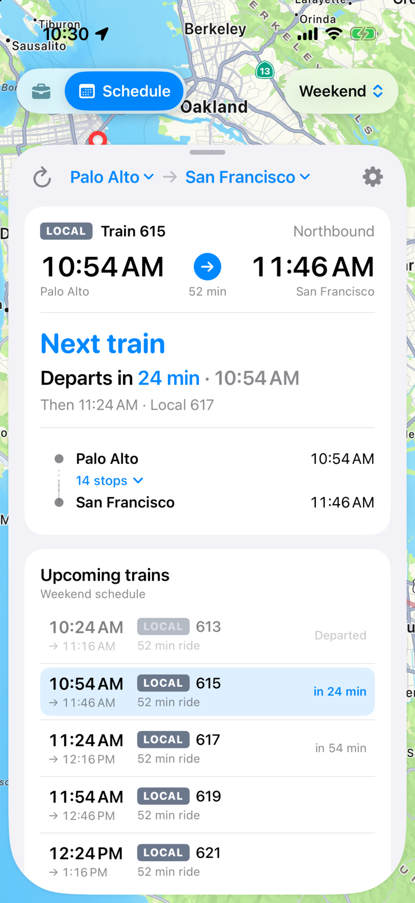
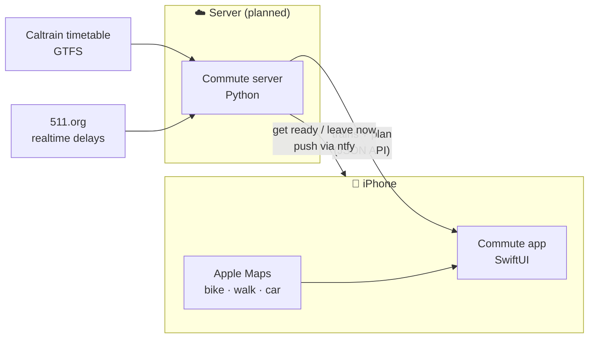

<div align="center">

# 🚆 Commute

**Know exactly when to leave for the train.**

A Caltrain commute planner for people who bike (or walk) to the station.
It picks your train, counts down to when you need to be out the door, and
rolls you onto the next train when you miss one.


&nbsp;

&nbsp;


</div>

---

## The idea

You don't care when the train departs. You care when you have to **leave the house**.

Commute works backwards from the train, using how long *you* take to get to the platform:

```
  7:50 ─────────── 8:10 ──────── 8:13 ─────────────── 8:15
  GET READY        LEAVE         TOO LATE              🚆 Limited 406 departs
  │◄── 20 min prep ─►│◄─ 3 min ─►│◄─ 2 min ride + platform ─►│
                       buffer
```

- **Target leave time.** Tell it when you'd like to leave home in the morning and work in the evening.
  It follows the first train you'd catch leaving then.
- **Get ready → Leave now → Too late.** The countdown moves through each stage as the minutes tick by.
- **Missed it? No drama.** Past "too late", it moves to the next train you can still catch and tells you when to leave for that one.
- **Alerts.** "Get ready" and "Leave now" notifications, even with the app closed. With location access, the app notices you've left and the rest of the trip stays quiet; on the way it shows when your train leaves, on board when it arrives, and a heads-up comes just before your stop.
- **Lock Screen countdown.** A Live Activity counts down to leaving, to the train, then to arrival, in the Dynamic Island too.
- **Your call.** Long-press a train in the list to pin it instead, or to say you're on it; tap it to see its stops. When an express would get you there sooner without leaving earlier, the card says so.
- **Commute or schedule.** On commute days around your target times the app plans your trip; on weekends, holidays and in between it opens as a plain timetable between any two stations. One tap switches. Until you add your home and work addresses, it's a timetable only.
- **Delays and cancellations.** Predicted times replace the timetable; a cancelled target train hands over to the next one. The card says which schedule runs today: weekday, weekend or holiday.

## Features

|  |  |
|---|---|
| 🚲 **Bike or walk** | Your door-to-platform minutes for each end, with an Apple Maps estimate to start from. Shows when you'll actually reach the door. |
| 📅 **Real timetable** | Downloads Caltrain's published schedule on first launch and keeps it on the phone. Refresh any time in Settings. |
| 🚄 **Train types** | Local, Limited, Express, South County. Turn off the ones you'd never take, and they disappear from planning. |
| 🗺️ **Map** | Your ride drawn along the real Caltrain track, the rest of the train's route faintly beyond it, and your train gliding along (its scheduled position, or live with the server). |
| 🔁 **Both directions** | Follows the morning trip until four hours after your target, then the evening one; tap the arrow on the card to switch by hand. |
| 🚗 **Car check** | Driving time against free-flow traffic, for days when the train isn't the answer. Tap for directions in Apple Maps, or hold for Google Maps. |
| ⚙️ **All 31 stations** | Pick an address and the nearest station is selected; override it if you ride to a faster stop. |

<div align="center">

&nbsp;

&nbsp;

</div>

## How it fits together



The app is built for two data sources:

- **Standalone** (default): Caltrain's timetable on the phone, live delays and cancellations from Caltrain's public feed (fetched only around a trip, at most every few minutes), alerts scheduled by the app. Nothing to host.
- **Server** (planned): your Commute server for live delays and push notifications that follow them,
  falling back to the timetable when it can't be reached. The code is in place; Settings offers only standalone for now.
Everything runs on free APIs; no billing account anywhere.

## Repository

| Folder | What's inside |
|---|---|
| [`client/`](client/) | The iOS app and its Swift package: `CommuteCore` (planner, models, tested on macOS) and `CommuteKit` (MapKit + SwiftUI) |
| [`server/`](server/) | The server: live Caltrain data and push notifications *(planned)* |

## Getting started

```bash
git clone git@github.com:grimsun/commute.git
cd commute/client
swift test                                  # planner and model tests
open CommuteApp/CommuteApp.xcodeproj        # run on an iPhone simulator
```

Requires Xcode 26+ and iOS 17+. See [`client/README.md`](client/README.md) for the architecture
and the debug launch arguments used to take the screenshots above.

---

<sub>Not affiliated with Caltrain. Timetable data from Caltrain's public GTFS feed.</sub>
