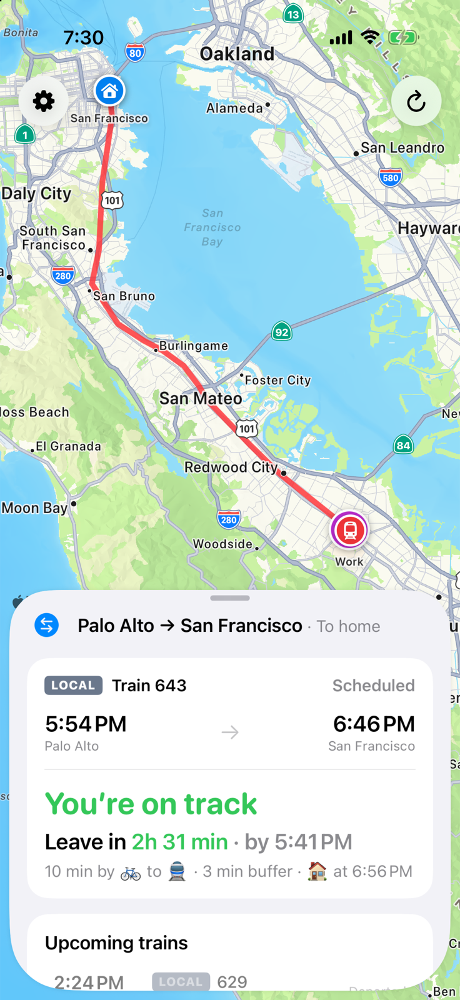
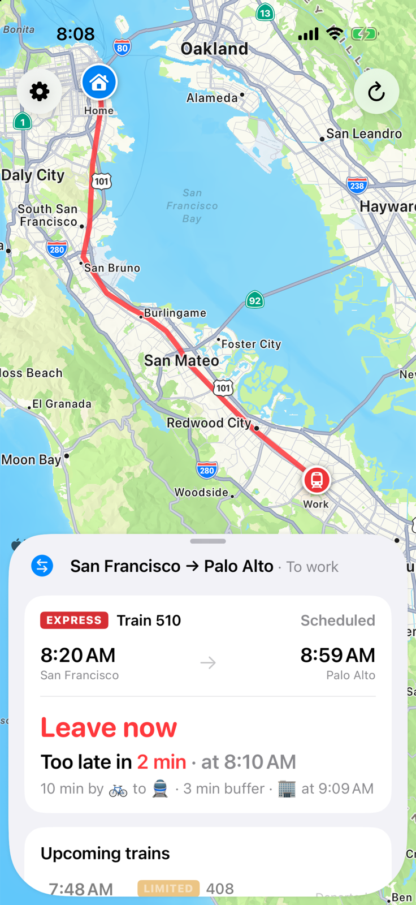
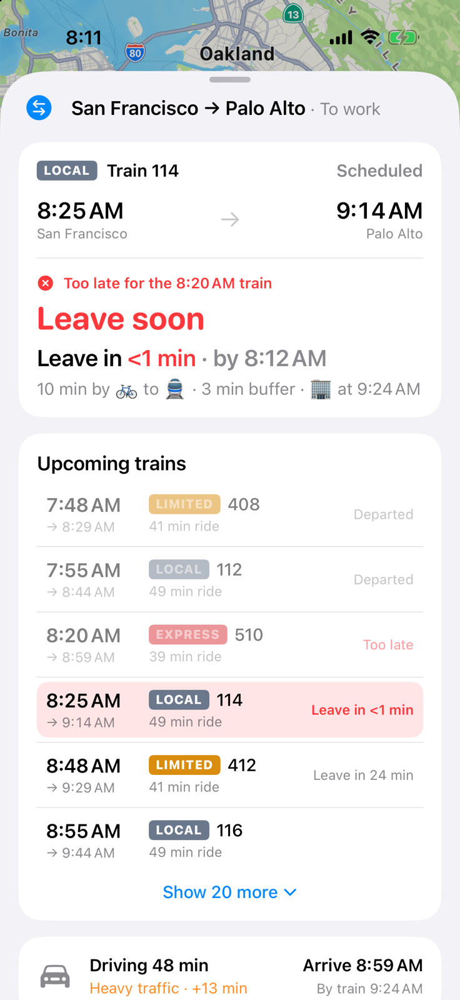
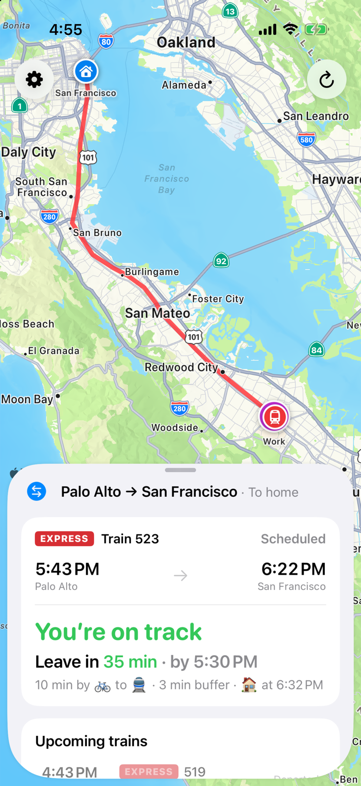
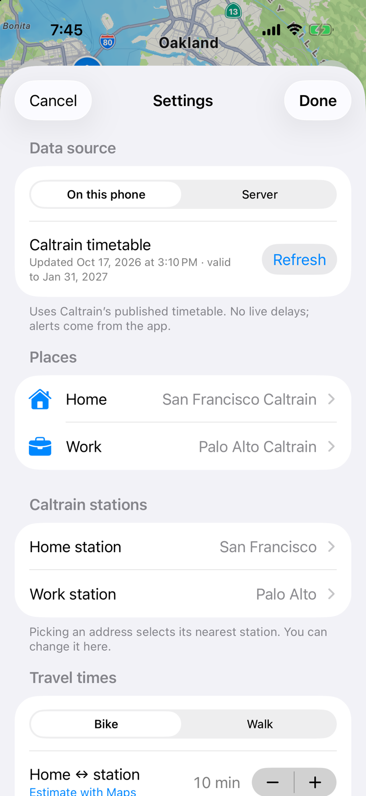
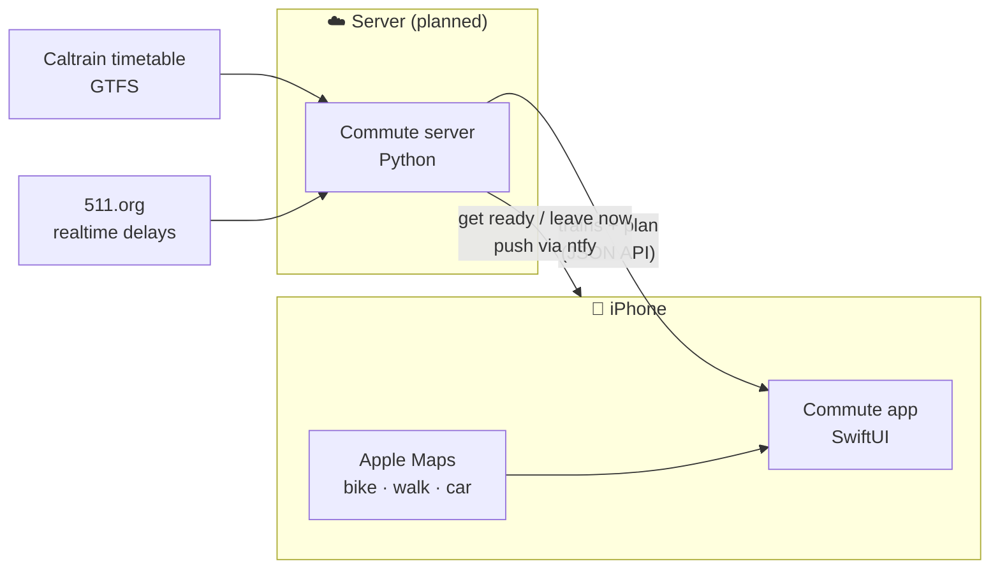

<div align="center">

# 🚆 Commute

**Know exactly when to leave for the train.**

A Caltrain commute planner for people who bike (or walk) to the station.
It picks your train, counts down to when you need to be out the door, and
rolls you onto the next train when you miss one.


&nbsp;

&nbsp;


</div>

---

## The idea

You don't care when the train departs. You care when you have to **leave the house**.

Commute works backwards from the train, using how long *you* take to get to the platform:

```
  7:50 ─────────── 8:10 ──────── 8:13 ─────────────── 8:15
  GET READY        LEAVE         TOO LATE              🚆 Limited 406 departs
  │◄── 20 min prep ─►│◄─ 3 min ─►│◄─ 2 min ride + platform ─►│
                       buffer
```

- **Target leave time.** Tell it when you'd like to leave home in the morning and work in the evening.
  It follows the first train you'd catch leaving then.
- **Get ready → Leave now → Too late.** The countdown moves through each stage as the minutes tick by.
- **Missed it? No drama.** Past "too late", it moves to the next train you can still catch and tells you when to leave for that one.
- **Alerts.** "Get ready" and "Leave now" notifications, even with the app closed. With location access, the app notices you've left and the rest of the trip stays quiet; on the way it shows when your train leaves, and on board when it arrives.
- **Your call.** Long-press any train in the list to make it the target instead.
- **Delays and cancellations** *(with the server).* Predicted times replace the timetable; a cancelled target train hands over to the next one.

## Features

|  |  |
|---|---|
| 🚲 **Bike or walk** | Your door-to-platform minutes for each end, with an Apple Maps estimate to start from. Shows when you'll actually reach the door. |
| 📅 **Real timetable** | Downloads Caltrain's published schedule on first launch and keeps it on the phone. Refresh any time in Settings. |
| 🚄 **Train types** | Local, Limited, Express, South County. Turn off the ones you'd never take, and they disappear from planning. |
| 🗺️ **Map** | Your home, work, both stations and the rail line between them, with a draggable sheet in the style of Apple Maps. |
| 🔁 **Both directions** | Follows the morning trip until four hours after your target, then the evening one; tap ⇆ to switch by hand. |
| 🚗 **Car check** | Driving time against free-flow traffic, for days when the train isn't the answer. |
| ⚙️ **All 31 stations** | Pick an address and the nearest station is selected; override it if you ride to a faster stop. |

<div align="center">

&nbsp;

</div>

## How it fits together



The app has two modes, switched in Settings:

- **Standalone** (default): Caltrain's timetable on the phone, alerts scheduled by the app. Nothing to host.
- **Server**: point the app at your Commute server for live delays and push notifications that follow them.
  If the server can't be reached, the app falls back to the timetable.
Everything runs on free APIs; no billing account anywhere.

## Repository

| Folder | What's inside |
|---|---|
| [`client/`](client/) | The iOS app and its Swift package: `CommuteCore` (planner, models, tested on macOS) and `CommuteKit` (MapKit + SwiftUI) |
| [`server/`](server/) | The server: live Caltrain data and push notifications *(planned)* |

## Getting started

```bash
git clone git@github.com:grimsun/commute.git
cd commute/client
swift test                                  # planner and model tests
open CommuteApp/CommuteApp.xcodeproj        # run on an iPhone simulator
```

Requires Xcode 26+ and iOS 17+. See [`client/README.md`](client/README.md) for the architecture
and the debug launch arguments used to take the screenshots above.

---

<sub>Not affiliated with Caltrain. Timetable data from Caltrain's public GTFS feed.</sub>
